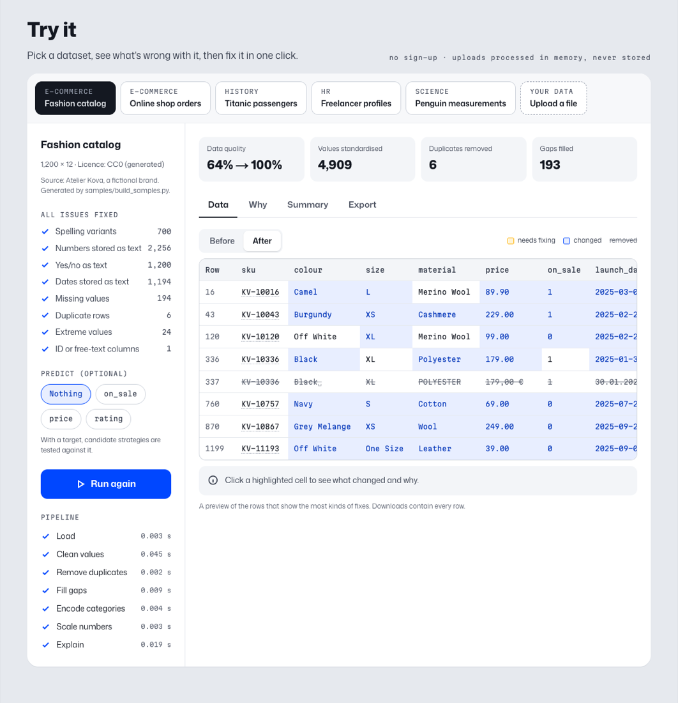

# Intelligent Data Preparation

**Messy data in, clean data out, with every change explained.**

An automated data preparation pipeline for tabular data. It repairs inconsistent values (spellings,
prices stored as text, German number and date formats, yes/no text, duplicates, ID columns), fills
gaps, prepares the data for machine learning and logs every decision. Where a target column is
given, preparation strategies are not guessed but tested against it.

**Live demo:** [parinaz-data-prep.vercel.app](https://parinaz-data-prep.vercel.app/) · English and German (the first upload can take about 30 seconds while the free API wakes up)



## What it does

| Step | What happens |
|---|---|
| Read | CSV in any encoding and delimiter (including German Excel exports with `;`), or Excel |
| Separate the target | The column to predict is set aside, so no step can alter it or leak it into evaluation |
| Repair values | `"NAVY"`/`"navy "`/`"Navy"` → `Navy`; `"89,90 €"`, `"EUR 1,299.00"`, `"84%"` → numbers; `Ja`/`nein`/`Y`/`False` → 1/0; `01.12.2025` read day-first |
| Remove | Exact duplicate rows; ID and free-text columns are kept in the clean file but left out of the analysis |
| Fill gaps | Numbers: mean, median or KNN, chosen by testing them; categories with many gaps get an explicit `(missing)` instead of a guess |
| Prepare for ML | Rare extremes capped, categories encoded, numbers scaled (in the ML-ready file only; the clean file keeps real values) |
| Explain | A JSON report of every decision and score, plus plain-language explanations and a summary in English and German |
| Export | Clean CSV, ML-ready CSV, report, and a Shopify product CSV for product catalogs |

### Test, don't guess

For imputation and scaling, a meta-model shortlists the two most promising strategies from the
column's statistics; each candidate is then cross-validated with a quick downstream model
(macro F1 for classification, R² for regression) and the better one is applied. The meta-models
are trained on synthetic datasets labelled with the strategy that actually scored best
(`train_meta_model.py`).

## Results

A reproducible benchmark (`benchmark.py`) on 7 datasets, including real data from OpenML
(Titanic, adult census, credit risk), 5 random splits each, scored with a linear model and a
random forest. Strategies are chosen on one half of each dataset and scored on the other half.

| Paired comparison | Wins / ties / losses | Mean difference |
|---|---|---|
| Automatic value cleaning vs. a static pipeline | 24 / 5 / 6 | +1.6 points |
| Choosing strategies by testing vs. good fixed defaults | 18 / 5 / 12 | +0.2 points |

Cleaning the values is what improves downstream models; testing strategies adds little on top on
these datasets, and meta-features of a single column do not reliably predict the best strategy
(they do shortlist better than fixed rules). Full tables: [`benchmark_results/RESULTS.md`](benchmark_results/RESULTS.md).

## Project structure

```
├── data_preparation.py       # AutoDataPreparer: the pipeline
├── meta_learning.py          # MetaLearner and MetaFeatureExtractor
├── train_meta_model.py       # Trains the meta-models on measured outcomes
├── benchmark.py              # Reproducible benchmark → benchmark_results/
├── test_pipeline.py          # Command-line runner for one data file
├── api/                      # FastAPI backend for the demo (explanations, Shopify export)
├── web/                      # Next.js demo app (static site)
├── samples/                  # Demo datasets with sources and licences (samples/SOURCES.md)
├── tests/                    # pytest suite
├── dashboard.py              # Earlier Streamlit dashboard for JSON reports
├── input/                    # Raw example datasets
├── meta_models/              # Trained meta-models (not committed) and evaluation feedback
├── paper/, new-paper/        # Seminar paper sources (LaTeX)
├── Dockerfile, render.yaml   # API deployment
└── .github/workflows/ci.yml  # Tests and web build on every push
```

## Run it locally

Requires Python 3.11+ and, for the web app, Node.js 20.9+ with pnpm.

```bash
python -m venv .venv && source .venv/bin/activate     # Windows: .venv\Scripts\activate
pip install -r requirements.txt

pytest                                                # test suite
python test_pipeline.py samples/fashion_catalog.csv --target on_sale --output-dir out/
python benchmark.py                                   # ~2 minutes, downloads 3 OpenML datasets once
python train_meta_model.py                            # optional: trained meta-models
```

Demo app:

```bash
uvicorn api.main:app --reload                         # API on http://localhost:8000
cd web && pnpm install && pnpm dev                    # site on http://localhost:3000
```

After changing the pipeline or the samples, regenerate the demo's pre-computed results with
`python -m api.export_samples`.

## Deploy

The site is static and the API is a small container, so each can be hosted on a free tier.

1. **API on Render:** New → Blueprint → this repository (`render.yaml`). Set `ALLOWED_ORIGINS`
   to the web app's address. Any other Docker host works too: `docker build -t data-prep-api .`
2. **Web app on Vercel:** New Project → this repository, Root Directory `web`. Set
   `NEXT_PUBLIC_API_URL` to the API's address. For GitHub Pages instead, build with
   `NEXT_PUBLIC_BASE_PATH=/<repository>` and publish `web/out`.

Free API instances sleep when idle; the sample datasets keep working meanwhile because their
results are pre-computed, and uploads show a short "starting up" notice.

## Privacy

Uploads are processed in a temporary directory that is deleted after the response, nothing is
stored, and uploaded data is never used for training. Limits: 5 MB, 20,000 rows.

## Sample data

UCI Online Retail (CC BY 4.0), OpenML Titanic, palmerpenguins (CC0), a Kaggle freelancer export
(CC0) and a generated catalog of the fictional brand Atelier Kova. Details: [`samples/SOURCES.md`](samples/SOURCES.md).

## About

Seminar project at FH Schmalkalden University of Applied Sciences.

Parinaz Teimouri · Applied Computer Science, FH Schmalkalden ·
[Portfolio](https://parinaz-teimouri.vercel.app/) · [LinkedIn](https://www.linkedin.com/in/parinaz-teimouri/)
